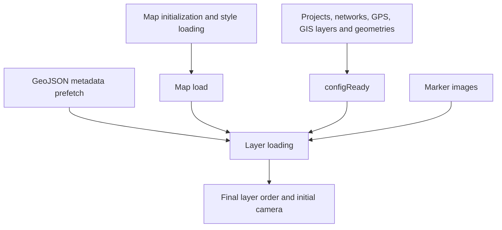

# Map Viewer Data Flow

## GeoJSON Loading Pipeline

Data flows from the Django backend through two phases: metadata fetch, then
per-project GeoJSON loading.

### Phase 1: Metadata Fetch

```
Django Backend
  │
  ├─ GET /api/v2/projects/                    → Config.loadProjects()
  │   Response: { success, data: [{ id, name, permission, country, color, ... }] }
  │   Stored in: Config._projects
  │   Note: `country` (ISO alpha-2 code) drives country grouping in ProjectPanel.
  │         `color` (hex string) is the model-assigned project color.
  │
  ├─ GET /api/v2/surface-networks/            → Config.loadNetworks()
  │   Response: { success, data: [{ id, name, user_permission_level, ... }] }
  │   Stored in: Config._networks
  │
  ├─ GET /api/v2/gps_tracks/                  → Config.loadGPSTracks()
  │   Response: { success, data: [{ id, name, color, file, ... }] }
  │   Stored in: Config._gpsTracks
  │
  ├─ GET /api/v2/gis-layers/                  → Config.loadGISLayers()
  │   Response: readable metadata with one signed renderable `file` URL
  │   Stored in: Config._gisLayers
  │
  └─ GET /api/v2/projects/geojson/        → API.getAllProjectsGeoJSON()
      Response: { success, data: [{ id, geojson_file, ... }] }
      Used for: Config.filterProjectsByGeoJSON()
      Purpose: Identify which projects have GeoJSON data, prune the rest
               from Config._projects so the UI only shows mappable projects
```

### Phase 2: Per-Project Data Loading (Parallel)

After metadata is fetched, data is loaded in parallel for all projects:

```
For each project in Config.projects (parallel via Promise.all):
│
├─ Stations: StationManager.loadStationsForProject(projectId)
│   ├─ Ensure one shared API.getAllStationsGeoJSON() request/cache
│   ├─ Filter cached features to this project after its read-access check
│   ├─ Store normalized records in State.allStations
│   └─ Layers.addSubSurfaceStationLayer(projectId, geojson)
│
└─ Survey: Layers.addProjectGeoJSON(projectId, url)
    ├─ fetch(url) → readViewerGeoJSON(response, { isCurrent })
    ├─ Optional public geographic-bound transform
    ├─ prepareProjectGeoJSON(data, { isCurrent })
    │   ├─ Resolve section averages and line depths
    │   ├─ Derive an immutable display copy with depth_val/depth_norm and Z=0
    │   └─ Collect project domain, snap endpoints, and bounds cooperatively
    ├─ Reject stale completion before publishing prepared state
    ├─ Cache domain and Geometry.cachePreparedSnapPoints(projectId, snapPoints)
    ├─ Reuse existing source with setData(), or add source and survey layers
    ├─ Publish prepared bounds to State.projectBounds
    └─ Schedule depth application from visible projects' cached domains
```

### `country` and `color` Field Flows

```
Config._projects (loaded from API)
  │
  ├─ country ──→ ProjectPanel._hasCountryData()
  │               └─ If any project has country: _renderGrouped()
  │                   ├─ Groups projects by country
  │                   ├─ Flag emoji via Utils.countryFlag(country)
  │                   ├─ Collapse state ↔ localStorage (COUNTRY_COLLAPSED key)
  │                   ├─ Country visibility ↔ localStorage (COUNTRY_VISIBILITY key)
  │                   └─ Two-level visibility:
  │                       ├─ Country toggle = visibility gate
  │                       ├─ Project visible only when BOTH country AND individual ON
  │                       └─ State.effectiveProjectVisibility tracks actual map state
  │
  └─ color ───→ Colors.getProjectColor(projectId)
                 ├─ Reads project.color from Config.getProjectById()
                 ├─ Caches in projectColorMap
                 ├─ Falls back to FALLBACK_COLOR (#94a3b8) WITHOUT caching
                 │   (retries on next call so timing issues resolve)
                 └─ Used by:
                     ├─ ProjectPanel: color dot per project row
                     └─ Layers.addProjectGeoJSON(): line-color paint property

Config._gpsTracks (loaded from API)
  │
  └─ color ───→ Colors.getGPSTrackColor(trackId)
                 ├─ Reads track.color from Config.getGPSTrackById()
                 ├─ Caches in gpsTrackColorMap
                 ├─ Falls back to FALLBACK_COLOR (#94a3b8) WITHOUT caching
                 └─ Used by: GPSTracksPanel (color dot), Layers (track line color)
```

Colors are fully model-driven. There is no JS-side palette array.

### Public Viewer Data Flow

The public viewer has a simpler single-phase pipeline:

```
fetch /api/v2/gis-ogc/view/{gisToken}/geojson
  │
  └─ Response: { success, data: { view_name, projects: [{ id, name, color, geojson_file }] } }
      │
      ├─ Config.setPublicProjects(projects)    Set read-only project list
      │   All projects get permissions = 'READ_ONLY'
      │   Maps `color` field (project_color from API)
      │
      └─ For each project (parallel):
          └─ Layers.addProjectGeoJSON(projectId, geojsonUrl)
              (same pipeline as private viewer from here)
```

---

## Startup Load Scheduling (Parallelism)

### Scheduling and prerequisites

Map style/tile loading, accessible metadata, and GeoJSON metadata are
independent requests. Starting them together overlaps their latency while
retaining explicit readiness gates before layer construction.



Private viewer (`main.ts`):

- **Map init is decoupled from data.** `MapCore.init()` runs immediately, so the
  selected provider style/tiles download concurrently with the API calls instead
  of after them.
- **Startup config loads run in parallel.** `Config.loadProjects()`,
  `loadNetworks()`, `loadGPSTracks()`, `loadGISLayers()`, and
  `loadGISGeometries()` start together as `configReady = Promise.all([...])`.
- **GeoJSON metadata is prefetched.** `loadGeoJSONMetadata()` starts during init
  (`metadataReady`) instead of inside the `map.on('load')` handler. Its caching
  is unchanged, so the source-change reload path still reuses the resolved
  value.
- **`loadMapData` awaits readiness, then overlaps.** It `await`s `configReady`
  before reading `Config.projects`, downloads marker images and the metadata
  concurrently (`Promise.all([loadMarkerImages(), metadataReady])`), and runs
  the independent layer phases (project/station, surface stations, landmarks,
  exploration leads, cylinder installs, and visible GPS/GIS overlays) as one
  `Promise.all`.

Public viewer (`gis_view_main.ts` through `read_only_viewer.ts`):

- The GIS-View metadata request starts during initialization (`pendingViewData`)
  and is consumed by `loadPublicMapData`, overlapping map style/tile loading.
  Later reloads retain the complete `sourceProjects` list separately from
  `Config.projects`, which may contain only projects surviving a geographic
  bound. Metadata is fetched again when source data is unavailable, an unbounded
  list is empty, or the caller requests fresh data.

### Scheduling invariants

- **Single authoritative reorder.** Because the layer phases run concurrently,
  exactly one `Layers.reorderLayers()` runs after the `Promise.all` to fix final
  z-order. The internal reorder calls inside individual phases remain harmless.
- **Markers ready before layers.** `loadMarkerImages()` still completes before
  any symbol layer is added (it is awaited before the layer `Promise.all`).
- **Cached project metadata on reload.** `configReady` / `metadataReady` /
  `pendingViewData` resolve once. Reload paths reuse cached config; the public
  composition retains complete source metadata across clipping and style
  changes, with the reload conditions described above.
- **No unhandled rejections.** `Config.load*` and `loadGeoJSONMetadata` swallow
  their own errors internally; the public prefetch attaches a no-op `.catch()`
  while real error handling still happens where the promise is consumed.

---

## CRUD Operation Flows

Entity mutations share an API boundary, while each manager owns its refresh
policy. The general flow is:

```
User Action (UI)
  │
  ├─ 1. UI Modal opens (station create, landmark edit, etc.)
  │
  ├─ 2. User fills form → submit
  │
  ├─ 3. API call via api.ts
  │     └─ Generated @speleodb/api operation + browser session adapter
  │         ├─ Resolves CSRF token at request time
  │         ├─ Uses generated JSON/multipart encoding
  │         └─ apiData unwraps documented success or throws ApiRequestError
  │
  ├─ 4. On success:
  │     ├─ Update State (e.g., State.allStations.set(id, data))
  │     ├─ Refresh through the manager or its entity event
  │     └─ Show success notification via Utils.showNotification()
  │
  └─ 5. Refresh event handler in main.ts:
        ├─ Load through the owning manager's cache/fetch policy
        ├─ Rebuild the affected map layer
        └─ Layers.reorderLayers()
```

### Subsurface Station CRUD

| Action      | API Method | Endpoint                                 | Refresh behavior                                                  |
| ----------- | ---------- | ---------------------------------------- | ----------------------------------------------------------------- |
| Create      | `POST`     | `/api/v2/projects/{projectId}/stations/` | `speleo:refresh-stations`                                         |
| Read        | `GET`      | `/api/v2/stations/{stationId}/`          | —                                                                 |
| Update      | `PATCH`    | `/api/v2/stations/{stationId}/`          | Details/label update in place                                     |
| Delete      | `DELETE`   | `/api/v2/stations/{stationId}/`          | `speleo:refresh-stations`                                         |
| Move (drag) | `PATCH`    | `/api/v2/stations/{stationId}/`          | Position update, then `speleo:refresh-stations` from confirmation |

Move flow includes magnetic snap: `Geometry.findNearestSnapPointWithinRadius()`
checks cached snap points within `MAGNETIC_SNAP_RADIUS` (default 10m). If
snapped, coordinates are adjusted to the nearest survey line vertex.

### Surface Station CRUD

| Action | API Method | Endpoint                                         | Refresh behavior                  |
| ------ | ---------- | ------------------------------------------------ | --------------------------------- |
| Create | `POST`     | `/api/v2/surface-networks/{networkId}/stations/` | `speleo:refresh-surface-stations` |
| Update | `PATCH`    | `/api/v2/stations/{stationId}/`                  | Details/label update in place     |
| Delete | `DELETE`   | `/api/v2/stations/{stationId}/`                  | `speleo:refresh-surface-stations` |

### Landmark CRUD

| Action      | API Method                                   | Endpoint                          | Refresh Event                     |
| ----------- | -------------------------------------------- | --------------------------------- | --------------------------------- |
| Create      | `POST`                                       | `/api/v2/landmarks/`              | Manager reload                    |
| Update      | `PATCH`                                      | `/api/v2/landmarks/{landmarkId}/` | Manager reload                    |
| Delete      | `DELETE`                                     | `/api/v2/landmarks/{landmarkId}/` | Manager reload                    |
| Move (drag) | `PATCH` via `LandmarkManager.moveLandmark()` | —                                 | Manager reload; revert on failure |

### Exploration Lead CRUD

| Action      | API Method                                      | Endpoint                                          | Refresh Event          |
| ----------- | ----------------------------------------------- | ------------------------------------------------- | ---------------------- |
| Create      | `POST`                                          | `/api/v2/projects/{projectId}/exploration-leads/` | Layer refresh inline   |
| Update      | `PATCH`                                         | `/api/v2/exploration-leads/{leadId}/`             | Layer refresh inline   |
| Delete      | `DELETE`                                        | `/api/v2/exploration-leads/{leadId}/`             | Layer refresh inline   |
| Move (drag) | `PATCH` via `ExplorationLeadManager.moveLead()` | —                                                 | Inline position update |

### Cylinder Install CRUD

| Action | API Method | Endpoint                                 | Refresh Event                      |
| ------ | ---------- | ---------------------------------------- | ---------------------------------- |
| Create | `POST`     | `/api/v2/cylinder-installs/`             | `speleo:refresh-cylinder-installs` |
| Update | `PATCH`    | `/api/v2/cylinder-installs/{installId}/` | `speleo:refresh-cylinder-installs` |
| Delete | `DELETE`   | `/api/v2/cylinder-installs/{installId}/` | `speleo:refresh-cylinder-installs` |

---

## Refresh Event System

Five custom refresh events drive layer refresh. Listeners in `main.ts` load
through the entity owner and rebuild the affected layers. Station managers reuse
their bulk GeoJSON cache until it is invalidated; dispatch alone does not force
a network request.

### `speleo:refresh-stations`

- **Payload**: `{ projectId }`
- **Dispatched by**: `Layers.refreshStationsAfterChange(projectId)`, called
  after station create/delete and by the confirmed-drag handler in `main.ts`
- **Handler**: Re-calls `StationManager.loadStationsForProject(projectId)`, then
  `Layers.addSubSurfaceStationLayer()`, then `Layers.reorderLayers()`
- **Scope**: Redraws one project. After cache invalidation, the manager fetches
  all readable subsurface stations once, then filters by project; otherwise it
  reuses the cached collection.

### `speleo:refresh-surface-stations`

- **Payload**: `{ networkId }`
- **Dispatched by**: `Layers.refreshSurfaceStationsAfterChange(networkId)`
- **Handler**: Re-calls
  `SurfaceStationManager.loadStationsForNetwork(networkId)`, then
  `Layers.addSurfaceStationLayer()`, then `Layers.reorderLayers()`
- **Scope**: Redraws one network. The manager filters its bulk surface-station
  cache, fetching all surface stations only when that cache is invalidated.

### `speleo:refresh-landmarks`

- **Payload**: (none)
- **Dispatched by**: Import and other callers requesting a global landmark
  refresh; manager CRUD also reloads directly
- **Handler**: Re-calls `LandmarkManager.loadAllLandmarks()`, then
  `Layers.addLandmarkLayer()`, then `Layers.reorderLayers()`
- **Scope**: Global — re-fetches all landmarks

### `speleo:refresh-gps-tracks`

- **Payload**: `{ deactivateAll? }`
- **Dispatched by**: GPX import (`upload.ts`)
- **Handler**:
  1. `State.gpsTrackCache.clear()` — invalidate all cached GeoJSON
  2. If `deactivateAll`, hide all visible GPS track layers
  3. `Config._gpsTracks = null` — force metadata reload
  4. `Config.loadGPSTracks()` — re-fetch track list from API
  5. `GPSTracksPanel.refreshList()` or `GPSTracksPanel.init()` — rebuild UI
- **Scope**: Global — full cache invalidation and reload

### `speleo:refresh-cylinder-installs`

- **Payload**: (none)
- **Dispatched by**: `cylinders.ts` after install/uninstall/pressure-check
  operations
- **Listener target**: `document` (not `window`, unlike other refresh events)
- **Handler**: `Layers.refreshCylinderInstallsLayer()` which calls
  `Layers.loadCylinderInstalls()` — full re-fetch of GeoJSON endpoint
- **Scope**: Global — re-fetches all cylinder installs

---

## Caching Strategies

### GPS Tracks — On-Demand Loading + Cache

GPS track GeoJSON is **not** loaded at initialization. Tracks default to OFF and
retain the established `Layers.toggleGPSTrackVisibility()` plus
`State.gpsTrackCache` lifecycle. GIS Layers do not alter that behavior.

```
User toggles track ON
  │
  ├─ State.gpsTrackCache.has(trackId)?
  │
  ├─ NO (first load):
  │   ├─ Layers.setGPSTrackLoading(trackId, true)
  │   │   └─ Dispatches speleo:gps-track-loading-changed → spinner in panel
  │   ├─ fetch(trackUrl) → GeoJSON data
  │   ├─ State.gpsTrackCache.set(trackId, geojsonData)
  │   ├─ Layers.addGPSTrackLayer(trackId, geojsonData)
  │   └─ Layers.setGPSTrackLoading(trackId, false)
  │
  └─ YES (cached):
      └─ Layers.showGPSTrackLayers(trackId, true)
          (just toggles visibility on existing map layers)
```

- **Storage**: `State.gpsTrackCache` (`Map<string, GeoJSON>`)
- **Invalidation**: `State.gpsTrackCache.clear()` on `speleo:refresh-gps-tracks`
- **Persistence**: Session-only. No localStorage. All tracks reset to OFF on
  page reload.

### GIS Layers — GPS Track Pattern

GIS Layer files are not loaded at initialization. Layers default to OFF and use
the same direct State/Layers flow as GPS Tracks.

```
User toggles GIS Layer ON
  │
  ├─ State.gisLayerCache.has(layerId)?
  │
  ├─ NO (first load):
  │   ├─ refresh authenticated detail metadata for a current signed URL
  │   ├─ fetch and parse the GeoJSON once
  │   ├─ cache that exact object and compute its bounds
  │   └─ add fill, outline, line, and point MapLibre layers
  │
  └─ YES (cached):
      └─ show the existing MapLibre layers
```

- **GIS delivery**: activation refreshes detail metadata before fetching the
  signed GeoJSON. The cache retains that exact payload. Cooperative
  `prepareGISLayerGeoJSONAsync()` derives display features with canonical type
  annotations, flattening geometry collections without copying coordinates;
  subtype filters therefore remain independent after MapLibre tiles Multi*
  geometries.
- **Invalidation**: a page reload starts a new session; a style rebuild re-adds
  visible layers from the cache.
- **Persistence**: session-only. No localStorage. All GIS Layers reset to OFF on
  page reload.
- **Camera**: a card-body click calls only `fitBounds`; toggle clicks never move
  the camera.

### Snap Points — Computed Once Per Project

When project GeoJSON is loaded, `prepareProjectGeoJSON()` extracts the start and
end vertices of every `LineString` during cooperative preparation.
`Geometry.cachePreparedSnapPoints()` publishes those endpoints only when the
prepared source is still current, avoiding another synchronous feature scan.

```
Layers.addProjectGeoJSON()
  └─ prepareProjectGeoJSON(geojsonData, { isCurrent, yieldWork })
      └─ For each LineString feature:
          ├─ Extract start coordinate (first vertex)
          └─ Extract end coordinate (last vertex)
      └─ Geometry.cachePreparedSnapPoints(projectId, snapPoints[])
```

- **Storage**: Module-level `snapPointsCache` (`Map<string, SnapPoint[]>`)
- **Used by**: `Geometry.findNearestSnapPointWithinRadius()` during drag
  operations for stations, exploration leads, and cylinder installs
- **Invalidation**: Replaced when current project GeoJSON is published; an empty
  replacement clears old snap endpoints.
- **Snap radius**: `MAGNETIC_SNAP_RADIUS = 10` meters (adjustable at runtime via
  `Geometry.setSnapRadius()`)

### Station Data — In-Memory Maps

All station data is kept in `State.allStations` and `State.allSurfaceStations`
as flat `Map<id, stationObject>` lookups.

- **Population**: During `StationManager.loadStationsForProject()` and
  `SurfaceStationManager.loadStationsForNetwork()`, each station is stored in
  the appropriate Map.
- **Used by**: Click handlers (to look up station metadata for modals), context
  menu (to check permissions), drag handlers (to read original coords).
- **Invalidation**: Overwritten on each `speleo:refresh-stations` /
  `speleo:refresh-surface-stations` event.

### Depth Domains — Per-Project + Merged

Depth data is computed during cooperative GeoJSON preparation and cached at two
levels:

```
prepareProjectGeoJSON(rawData, { isCurrent, yieldWork, budgetMs })
  │
  ├─ Accumulate Point depth sums/counts by section_name
  ├─ Resolve LineString direct depth or section average → { min: 0, max }
  ├─ Copy changed geometry/properties, flatten Z, stamp depth_val/depth_norm
  ├─ Collect snap endpoints and bounds in the same coordinate walk
  └─ Return { data, domain, snapPoints, boundsCoordinates }
      └─ Caller publishes only the current complete revision
```

Preparation never mutates the downloaded object. Unchanged metadata and 2D
coordinate leaves are structurally shared and must be treated as immutable.
There is no stringify/parse clone. Coordinate traversal, section processing, and
longitude sorting yield according to `DEFAULTS.VIEWER_WORK.BUDGET_MS`, including
inside one very large line or polygon. Concurrent preparations share the same
slice deadline and yield before starting, so many ready downloads do not
multiply the allowed blocking time. The wrapped bounds algorithm still chooses
the smallest antimeridian extent, and a valid authoritative GeoJSON `bbox` still
wins. `prepareGeoJSONBounds()` provides the same cooperative bounds calculation
for sources that do not need project depth preparation; `wrapLongitude: false`
retains GIS authoring extents.

`isCurrent()` is checked before starting, at yields, and before returning.
Superseded work rejects with `AbortError` and never publishes partial data.
Callers also check their source/style generation before applying a result.
Depth-mode and visibility changes use the cached domain; they must not rerun
preparation or traverse coordinates.

Basemap switching captures base-layer IDs and their visibility before viewer
sources load. Later changes update only those cached layers in cooperative
batches and never call `getStyle()`, which would serialize every survey source.
Tokenless raster styles retain a transparent background anchor so replacement
raster layers stay below overlays without inspecting the complete style.

The preparation tests cover source immutability, depth parity, authoritative
bounds, nested coordinates, antimeridian handling, cancellation, and yielding
within coordinate arrays. Runtime traces should distinguish preparation slices
from JSON parsing and renderer ingestion, which are separate work.

`readViewerGeoJSON(response, { isCurrent, yieldWork })` transfers downloaded
buffers at or above `DEFAULTS.VIEWER_WORK.WORKER_PARSE_BYTES` to a Vite module
worker for JSON parsing. It sends no network requests and carries no
credentials. The worker uses `geoJSONMessages` and the receiver uses
`applyGeoJSONNodes` from `@speleodb/map-core/geojson-transport`. Parsed JSON
returns in batches of tree nodes controlled by
`DEFAULTS.VIEWER_WORK.WORKER_NODE_BATCH_SIZE`; the main thread yields before
acknowledging each batch. This prevents a single large structured clone from
replacing the parsing stall. Completion returns the original GeoJSON shape for
existing caches; cancellation and errors terminate the worker, and parser errors
never include private source excerpts.

Small responses use direct parsing. Environments without Worker support retain
native response parsing. Worker construction/CSP failures are reported as load
failures, so deployment CSP must permit same-origin module workers. Arrays and
objects are reconstructed incrementally, including inside a single large
geometry; only small coordinate positions travel as complete arrays. This
transport does not remove map renderer ingestion or GPU costs.

When project visibility changes or new projects load:

```
Layers.recomputeActiveDepthDomain()
  │
  ├─ Collect domains from visible projects only
  ├─ mergeDepthDomains(activeDomains) → { min: 0, max: globalMax }
  ├─ State.activeDepthDomain = merged
  │
  └─ Layers.emitDepthDomainUpdated()
      ├─ Dispatches speleo:depth-domain-updated
      └─ Dispatches speleo:depth-data-updated (legacy)
```

- **Per-project storage**: `State.projectDepthDomains`
  (`Map<string, {min,max}|null>`)
- **Merged storage**: `State.activeDepthDomain` (`{min, max}|null`)
- **Used by**: `Colors.getDepthPaint(depthDomain)` which produces a MapLibre
  `interpolate` expression mapping `depth_val` to a blue→yellow→red gradient
- **Recomputed when**: Project visibility toggled, new GeoJSON loaded, color
  mode switched to depth

### Effective Visibility

`State.effectiveProjectVisibility` is a `Map<string, boolean>` that records
whether each project is actually visible on the map. It is set inside
`applyProjectLayerVisibility` **before** the map layer guard, so consumers
always get the real state even if the map hasn't rendered that project's layers
yet.

`getVisibleProjectIds()` reads from `effectiveProjectVisibility` (not
`projectLayerStates`), so stations, leads, cylinders, and depth domains all
respect the two-level country gate.

`toggleProjectVisibility` clears the stale `effectiveProjectVisibility` entry
for the project before re-applying visibility, ensuring the map stays
consistent.

### Project-Scoped Marker Visibility

Cylinder installs and exploration leads are stored in global layers but scoped
to projects via a `project_id` property on each feature. When project visibility
changes:

```
Layers.applyProjectScopedMarkerVisibility()
  │
  ├─ Build list of visible project IDs (from effectiveProjectVisibility)
  ├─ Construct MapLibre filter expression:
  │   ['any',
  │     ['!', ['has', 'project_id']],     ← markers without project scope stay visible
  │     ['==', ['get', 'project_id'], null],
  │     ['in', ['to-string', ['get', 'project_id']], [...visibleIds]]
  │   ]
  │
  └─ Apply filter to: cylinder-installs-layer, cylinder-installs-labels,
                       exploration-leads-layer
```

This avoids rebuilding these layers when project visibility changes — only the
MapLibre filter expression is updated.

### Landmark Collections

Landmark collection state is loaded independently from Landmark GeoJSON:

```
LandmarkManager.loadCollections()
  └─ GET /api/v2/landmark-collections/
      └─ State.landmarkCollections: Map<collectionId, permission-aware metadata + color>

LandmarkManager.loadAllLandmarks()
  └─ GET /api/v2/landmarks/geojson/
      └─ State.allLandmarks: Map<landmarkId, geometry + collection + color + can_* flags>
```

The order matters for selectors, grouping, and color fallback. Collection rows
provide the write/admin flags and model color used by assignment dropdowns and
collection group headers; Landmark GeoJSON provides per-feature `can_write`,
`can_delete`, and `collection_color` flags used by the manager, map layer,
context menu, and drag confirmation path.

## Public GIS View Geographic Bound

The public metadata response optionally supplies a live Polygon bound. The web
composition uses map-core clipping through the survey loader transform hook,
after raw GeoJSON parsing and before preparation. Only retained features drive
map sources, extents, depth calculations and the visible project list. Complete
project inputs remain available for style reloads. Raw downloads and OGC remain
unrestricted. See [Geographic Bound](../gis-view-geographic-bound.md).
